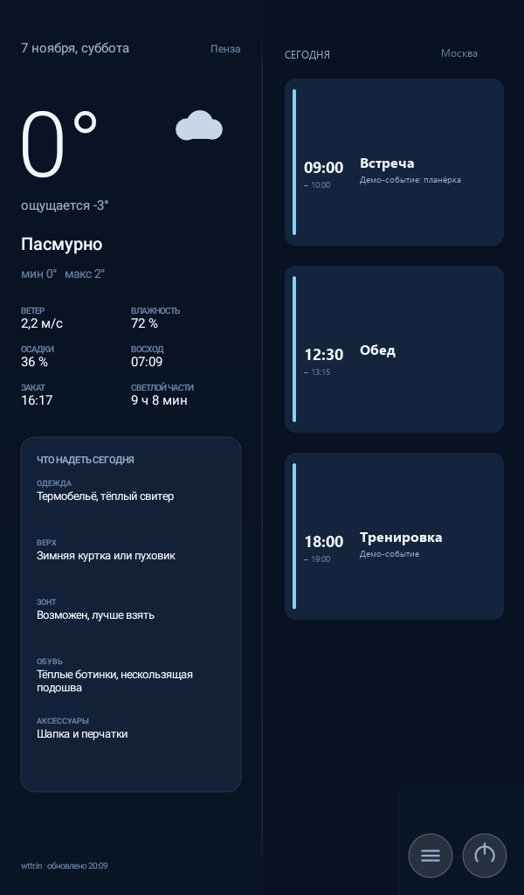
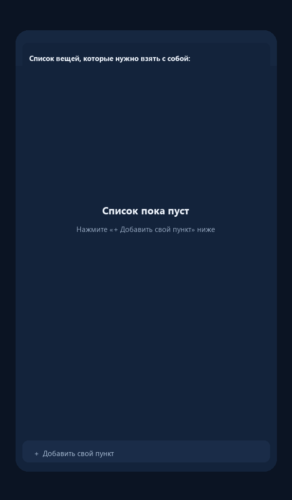
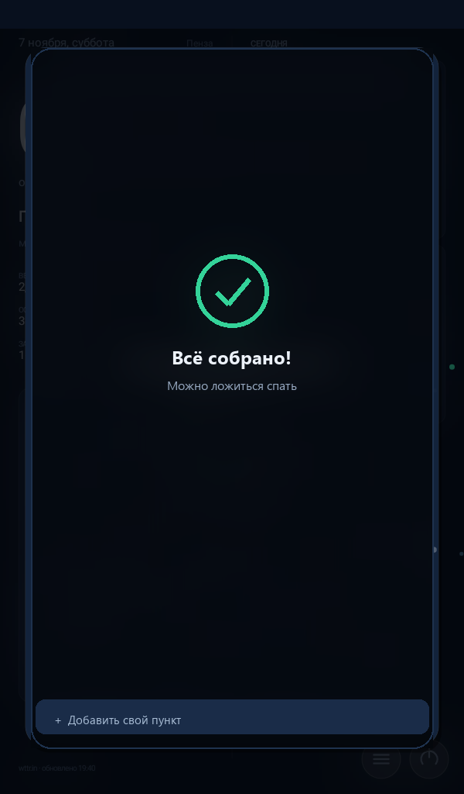

# Smart Dashboard

**A full-screen information panel for an old Android tablet: today's weather, what to wear, today's calendar and an evening packing checklist — no root, no Google Play, no third-party libraries.**

[](#)
[](#)
[](LICENSE)
[](#)

> ## ⚠️ Tested on one tablet only
>
> Smart Dashboard was developed and verified on **exactly one device** — a **Huawei MediaPad T3 7 (BG2-U01)** running **Android 7.0** (API 24), with a **600×1024** screen.
> It has **not** been tested on any other phone or tablet.
> Before you rely on it every day, test it on your own device — see [docs/en/TESTING.md](docs/en/TESTING.md) for a checklist.
> **Use it at your own risk.**

| Day dashboard | Evening packing list | Everything is packed |
|---|---|---|
|  |  |  |

The screenshots are demos: the city, the calendar events and the packing items are fictional. All images live in [docs/screens](docs/screens/README.md).

## Contents

- [What it is](#what-it-is)
- [What it shows](#what-it-shows)
- [Quick start](#quick-start)
- [Specifications](#specifications)
- [What it can't do](#what-it-cant-do)
- [If the screen does not fit your tablet](#if-the-screen-does-not-fit-your-tablet)
- [Repository structure](#repository-structure)
- [Documentation](#documentation)
- [License](#license)

## What it is

Smart Dashboard turns a spare Android tablet into a home information screen (a kiosk). You mount the tablet on a wall or a stand, leave it plugged in, and the app shows the things you want to see at a glance:

- **today's weather** and a practical "what to wear today" block on the left half of the screen;
- **today's calendar events** on the right half;
- an **evening packing checklist** that appears at 20:00, so you do not forget anything the next morning.

The app wakes the screen at 08:00, switches to night mode and turns the screen off at 21:00, starts automatically after a reboot, and keeps working offline with the last cached weather.

It is deliberately tiny and old-school: one activity, one custom `Canvas` view, no AndroidX, no Gradle dependency graph, no Google Play Services, no root. The APK is **about 60 KB**.

> The on-screen interface is currently in Russian (the app is not localized yet); this repository is documented in both English and Russian.

## What it shows

| Left half (50%) | Right half (50%) |
|---|---|
| Date and weekday | Today's calendar events, sorted by start time |
| City (auto-detected or set in the config) | Time, title and description on each event card |
| Current and "feels like" temperature, daily min/max | Cards shrink automatically when the day is busy (up to 12 events) |
| Weather condition with a drawn icon, rain probability, wind, humidity, sunrise/sunset, daylight length | **Empty day = empty half.** No placeholders, no "nothing planned" text |
| **"What to wear today"**: clothes, outerwear, umbrella, shoes, accessories | |

**Evening packing list**

- Opens at **20:00** (Saturday is skipped by default) or any time via the **≡** button.
- A centered card over the blurred dashboard: tap an item to check it off (strikethrough, dimmed).
- **The list is empty by default** — starting with version 1.3 everyone adds their own items via **`+  Добавить свой пункт`** ("+ Add your own item") in the evening window. Items are stored locally in the app's settings.
- Long-press a custom item to delete it.
- When everything is checked: a green check mark, a small fireworks animation, **`Всё собрано!`** / **`Можно ложиться спать`** ("All packed!" / "You can go to bed"), and the window closes by itself after about 5.6 seconds.
- Optional: a "Notebook (tomorrow's subjects from the calendar)" item can be enabled in the config. It is **off** by default.

**Buttons in the bottom-right corner**

| Button | What it does |
|---|---|
| **≡** | Opens the packing list immediately (no need to wait for 20:00) |
| **⏻** | Opens the standard Android power menu (via the app's accessibility service, because a normal Android 7 app cannot power off the device itself) |

**Schedule and behaviour**

| Time (configurable in `DeviceConfig`) | What happens |
|---|---|
| 08:00 | The screen wakes up and switches to day brightness |
| 08:00–21:00 | The screen stays on at a comfortable brightness |
| 20:00 (except Saturday by default) | The evening packing list appears over the dashboard |
| 21:00 | Night mode: the screen is dimmed to near-black and then turns off |
| Any touch at night | The screen wakes up for 5 minutes, then returns to night mode |
| After a reboot | The panel starts automatically (`BOOT_COMPLETED`) and re-registers its alarms |

Weather is refreshed every 30 minutes, the calendar every 5 minutes, and immediately when the network comes back. If there is no network, the panel keeps the last cached data and shows **`Нет сети · данные ЧЧ:ММ`** ("No network · data as of HH:MM") in the bottom-left corner.

## Quick start

1. **Download the APK** — take [`apk/SmartDashboard-1.3.apk`](apk/SmartDashboard-1.3.apk) from this repository or from the [Releases page](https://github.com/Miles64girt/smart-dashboard/releases).
2. **Install it manually** — you will have to allow installation from unknown sources and confirm a Play Protect warning. Step-by-step instructions: [docs/en/INSTALL.md](docs/en/INSTALL.md).
3. **Grant the calendar permission** — the app asks for `READ_CALENDAR` on first launch so it can show today's events.
4. **Optionally enable the accessibility service** — only needed for the **⏻** power button; everything else works without it.
5. **Add your own packing items** — open the list with **≡** or wait for 20:00 and use **`+  Добавить свой пункт`**. The list is empty out of the box on purpose: there are no personal items baked into the app.

> **Huawei / EMUI users:** allow Smart Dashboard to auto-start and exclude it from battery optimization, otherwise the 08:00/21:00 alarms and the boot autostart may be blocked. See [docs/en/INSTALL.md](docs/en/INSTALL.md).

To build the APK yourself instead of downloading it, follow [docs/en/BUILD.md](docs/en/BUILD.md).

## Specifications

| Parameter | Value |
|---|---|
| Package | `ru.home.dashboard` |
| Language | Java (no Kotlin) |
| minSdk / targetSdk | 24 / 24 (Android 7.0) |
| Third-party libraries | **none** — Android framework only (`Canvas`, `HttpURLConnection`, `org.json`) |
| APK size | **about 60 KB** |
| Memory footprint | about 12 MB PSS |
| UI rendering | One custom `View` drawn on `Canvas`; no XML layouts, no image assets |
| Weather | wttr.in (free, no API key; city auto-detected by IP or set manually); optional Open-Meteo fallback for manually set coordinates; result cached on disk |
| Calendar | System `CalendarContract` (read-only); works with whatever accounts Android has synced |
| Refresh intervals | Weather every 30 min, calendar every 5 min, immediate refresh when the network returns |
| Daily schedule | 08:00 wake-up / 21:00 night mode / 20:00 packing list; configurable |
| Autostart | After reboot (`BOOT_COMPLETED`) |
| Baseline layout | 600×1024 portrait, scaled to the screen with `min(width / 600, height / 1024)` |
| Orientation | Portrait and upside-down portrait; landscape is not supported |
| Root / custom ROM / GMS | Not required |
| License | MIT |

## What it can't do

Be honest with yourself before installing:

- It **cannot fully power off the tablet** at 21:00 — it turns the screen off, and the device stays on.
- It **cannot wake the tablet from a fully powered-off state** — Android 7 has no boot-by-alarm here. Keep the tablet on (or use a smart plug).
- It **does not support landscape orientation** — the layout is designed for portrait.
- It **depends on wttr.in** for weather. If the service is unreachable, you get cached data with an "offline" note.
- It **has no settings screen** — the city, schedule, brightness and default packing items are set in `DeviceConfig.java` and require a rebuild.
- It **shows only weather, today's calendar and the packing list** — there are no arbitrary widgets or extra pages.
- It was **tested only on one tablet**, as stated above.

The full list, explained one by one, is in [docs/en/LIMITATIONS.md](docs/en/LIMITATIONS.md).

## If the screen does not fit your tablet

The layout uses a **600×1024** baseline and scales by `min(width / 600, height / 1024)`. On a screen with another aspect ratio you will get letterboxing, not a broken layout — but it is still worth checking.

If your tablet has a different resolution, an unusual aspect ratio or a broken system time zone, adapt the app through a single config file, [`app/src/ru/home/dashboard/DeviceConfig.java`](app/src/ru/home/dashboard/DeviceConfig.java):

- time zone, city and coordinates (or IP-based auto-detection);
- schedule hours and brightness levels;
- default packing items and the optional notebook from the calendar;
- baseline design width/height.

The adaptation guide is [docs/en/ADAPT.md](docs/en/ADAPT.md). It also explains how to use [PROMPT_EN.md](PROMPT_EN.md) — a ready-to-copy prompt that lets an AI assistant walk you through the adaptation for your exact device.

## Repository structure

```
smart-dashboard/
├─ README.md                 # Russian landing page
├─ README.en.md              # English landing page (this file)
├─ CHANGELOG.md              # Version history
├─ PROMPT_RU.md / PROMPT_EN.md   # AI adaptation prompts
├─ LICENSE                   # MIT
├─ apk/
│  └─ SmartDashboard-1.3.apk # Ready-to-install signed APK
├─ app/
│  ├─ AndroidManifest.xml
│  ├─ res/                   # strings, icons, network security config, ISRG roots
│  └─ src/ru/home/dashboard/ # Java sources (DeviceConfig, views, repositories, receivers)
├─ build/
│  ├─ build.ps1              # Build without Gradle: aapt2 → javac → d8 → zipalign → apksigner
│  └─ README.md              # Short build notes
├─ scripts/                  # setup_build_env, install_deploy, dashboard, uninstall
└─ docs/
   ├─ screens/               # Anonymized demo screenshots
   ├─ ru/                    # Russian documentation
   └─ en/                    # English documentation (INSTALL, BUILD, ADAPT, TESTING, ARCHITECTURE, FAQ, LIMITATIONS)
```

## Documentation

| English | Russian |
|---|---|
| [INSTALL — install the ready APK](docs/en/INSTALL.md) | [docs/ru/INSTALL.md](docs/ru/INSTALL.md) |
| [BUILD — build from source](docs/en/BUILD.md) | [docs/ru/BUILD.md](docs/ru/BUILD.md) |
| [ADAPT — adapt to your device](docs/en/ADAPT.md) | [docs/ru/ADAPT.md](docs/ru/ADAPT.md) |
| [TESTING — what was tested and how to test yours](docs/en/TESTING.md) | [docs/ru/TESTING.md](docs/ru/TESTING.md) |
| [ARCHITECTURE — how it works inside](docs/en/ARCHITECTURE.md) | [docs/ru/ARCHITECTURE.md](docs/ru/ARCHITECTURE.md) |
| [FAQ — frequently asked questions](docs/en/FAQ.md) | [docs/ru/FAQ.md](docs/ru/FAQ.md) |
| [LIMITATIONS — the honest limits](docs/en/LIMITATIONS.md) | [docs/ru/LIMITATIONS.md](docs/ru/LIMITATIONS.md) |
| [Screenshots and captions](docs/screens/README.md) | — |
| [Changelog](CHANGELOG.md) | — |

## Tested on

Huawei MediaPad T3 7 (**BG2-U01**), Android 7.0 / API 24, 32-bit, 1 GB RAM, 600×1024 screen, 213 dpi, EMUI 5.1. Details of what was checked and a self-test checklist for your own tablet: [docs/en/TESTING.md](docs/en/TESTING.md).

Thanks to [wttr.in](https://wttr.in/) for the free weather forecast without an API key, [Open-Meteo](https://open-meteo.com/) for the fallback source, and the Android platform for `CalendarContract` and RenderScript, which made it possible to skip third-party libraries.

## License

MIT. See [LICENSE](LICENSE).

Copyright (c) 2026 Miles64girt.
