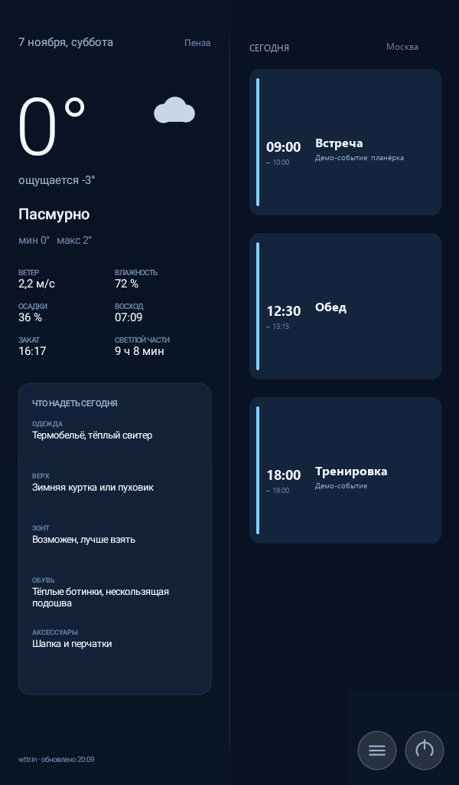
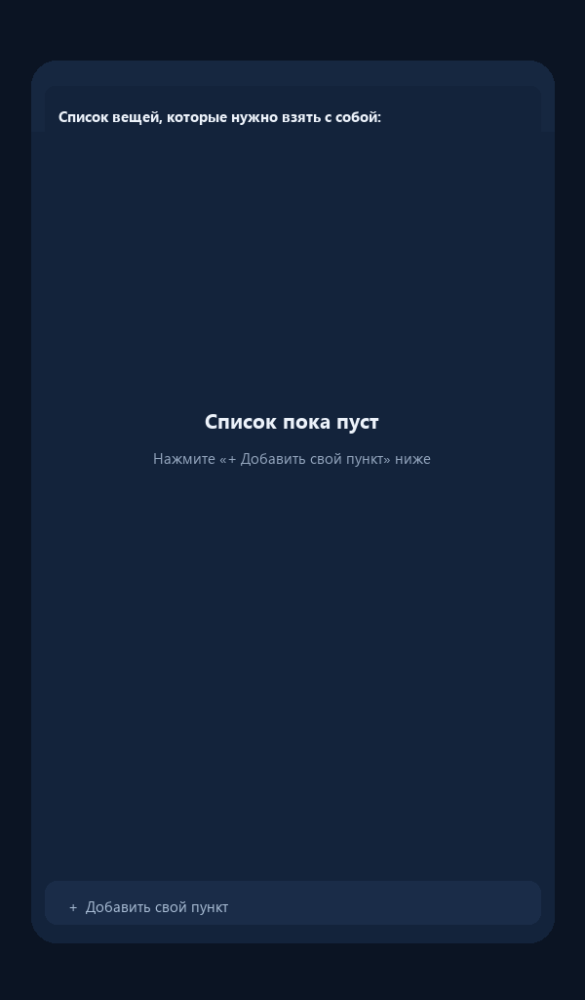
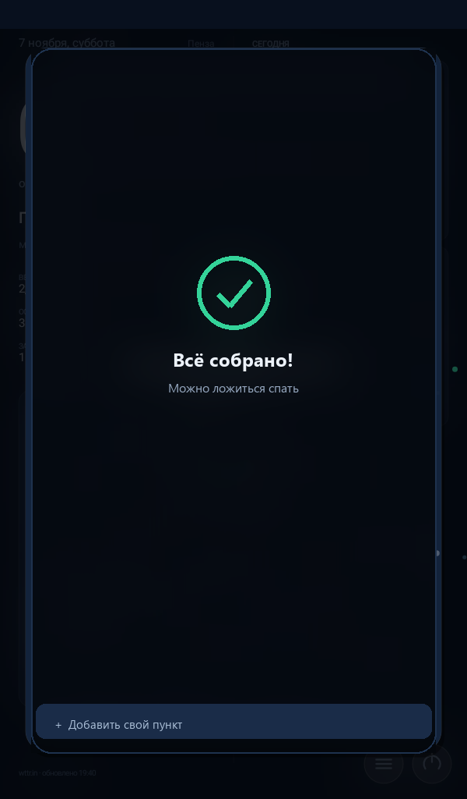

# Smart Dashboard

**Информационная панель на весь экран для старого Android-планшета.** Погода, рекомендации по одежде и события календаря на сегодня — на одном экране, днём и ночью. Без root, без Google Play, без единой сторонней библиотеки: всё рисуется на `Canvas`, APK весит около 60 КБ.

[](https://developer.android.com/about/versions/nougat)


[](LICENSE)

---

> ## ⚠️ Проверено только на одном планшете
>
> Приложение разработано и проверено **только на Huawei MediaPad T3 7 (BG2-U01)**: Android 7.0, 32-бит, 1 ГБ ОЗУ, экран 600×1024, EMUI 5.1.
>
> **На других устройствах оно не тестировалось.** Прежде чем оставлять его работать постоянно, проверьте всё сами по [чек-листу для своего устройства](docs/ru/TESTING.md). Используете на свой риск.

---

| Дневная панель | Вечерний список | Всё собрано |
|---|---|---|
|  |  |  |

Скриншоты демонстрационные: город, события и вещи — вымышленные. Все изображения — в [docs/screens](docs/screens/README.md).

## Оглавление

- [Что это](#что-это)
- [Что показывает](#что-показывает)
- [Характеристики](#характеристики)
- [Быстрый старт](#быстрый-старт)
- [Чего приложение не умеет](#чего-приложение-не-умеет)
- [Если экран не подходит вашему планшету](#если-экран-не-подходит-вашему-планшету)
- [Структура репозитория](#структура-репозитория)
- [Документация](#документация)
- [Проверено на…](#проверено-на)
- [Лицензия](#лицензия)

## Что это

Лёгкое нативное приложение для Android, которое превращает старый планшет в домашний информационный экран — что-то вроде киоска на кухне или в прихожей. Планшет включается утром, показывает погоду и расписание дня, вечером напоминает собрать вещи, ночью спит.

Проект вырос из личной задачи: планшет 2017 года лежал без дела, а держать на виду погоду и календарь было удобно. Приложение специально сделано максимально простым — один экран, ноль зависимостей, минимум памяти. Его можно собрать без Android Studio и Gradle обычным `build.ps1` на Windows.

## Что показывает

### Левая половина

- дата и день недели на русском;
- город — определяется автоматически по IP или задаётся в конфиге;
- текущая и ощущаемая температура, минимум и максимум на день;
- состояние погоды с нарисованной вручную иконкой, вероятность осадков, ветер, влажность, восход, закат и длина светового дня;
- блок **«Что надеть сегодня»**: одежда, верхняя одежда, зонт, обувь, аксессуары — по ощущаемой температуре, ветру и осадкам.

### Правая половина

- события календаря **только на сегодня**, отсортированные по времени начала;
- карточки: время начала и окончания, название, краткое описание;
- если событий много, карточки автоматически уплотняются, чтобы всё поместилось;
- если событий нет — половина просто пустая, без заглушек и надписей.

### Вечерний список вещей

- в **20:00** (по умолчанию кроме субботы) на экране появляется окно-чек-лист на размытом фоне панели;
- **список по умолчанию пуст** — каждый добавляет свои вещи сам через «**+ Добавить свой пункт**»;
- отметка — тап по квадрату: пункт зачёркивается и бледнеет; долгое нажатие на свой пункт удаляет его;
- когда отмечено всё — зелёная галочка, салют и автозакрытие через несколько секунд;
- опционально можно включить пункт «Тетрадь (предметы из календаря на завтра)» — по умолчанию выключен.

### Расписание и экран

- **08:00** — экран включается, дневная яркость; **21:00** — ночной режим, экран гаснет;
- ночью касание включает экран на 5 минут;
- автозапуск после перезагрузки;
- полноэкранный режим, экран не гаснет в дневное время;
- портрет и перевёрнутый портрет (планшет можно закрепить «вверх ногами»);
- кнопки в правом нижнем углу: **≡** — открыть список вещей вручную, **⏻** — системное меню питания.

## Характеристики

| Параметр | Значение |
|---|---|
| Пакет | `ru.home.dashboard` |
| Язык | Java (Android framework, без Kotlin) |
| minSdk / targetSdk | 24 / 24 (Android 7.0) |
| Ориентация | портрет и перевёрнутый портрет; альбомная отключена |
| Сторонние библиотеки | нет — только Android framework и встроенный `org.json` |
| Размер APK | около 60 КБ |
| Память | около 12 МБ PSS |
| Погода | wttr.in (бесплатно, без ключа), резерв Open-Meteo при заданных координатах, кэш на диск |
| Календарь | `CalendarContract`, только чтение |
| Расписание | 08:00 / 20:00 / 21:00, настраивается в конфиге |
| Автозапуск | `BOOT_COMPLETED` |
| Сборка | без Gradle: aapt2 → javac → d8 → zipalign → apksigner |
| Root | не нужен |
| Лицензия | MIT |

## Быстрый старт

1. **Скачайте APK** — из папки [`apk/`](apk/) репозитория (`SmartDashboard-1.3.apk`) или со страницы [Releases](https://github.com/Miles64girt/smart-dashboard/releases).
2. **Установите вручную.** На планшете понадобится разрешить установку из неизвестных источников. Play Protect может предупредить, что приложение не проверено, — это нормально для APK не из магазина.
3. **Выдайте разрешение на календарь** (`READ_CALENDAR`) — без него правая половина будет пустой. Контакты, звонки и другие данные приложению не нужны.
4. **По желанию включите службу доступности** — только ради кнопки **⏻** с системным меню питания. Приложение ничего не читает и не нажимает само.
5. **Добавьте свои вещи:** нажмите **≡**, затем «**+ Добавить свой пункт**».

Подробно, шаг за шагом — в [docs/ru/INSTALL.md](docs/ru/INSTALL.md). Сборка из исходников — в [docs/ru/BUILD.md](docs/ru/BUILD.md).

## Чего приложение не умеет

- **Не выключает планшет полностью.** В 21:00 оно гасит экран; устройство остаётся включённым. Полное выключение без root невозможно.
- **Не включается само из выключенного состояния** — аппаратного автовключения по таймеру у планшета нет.
- **Не работает в альбомной ориентации** — интерфейс рассчитан на портрет.
- **Не настраивается из интерфейса** — город, расписание, яркость и стартовый список вещей задаются в `DeviceConfig.java` и требуют пересборки.
- **Не показывает ничего, кроме погоды, календаря и списка вещей** — произвольных виджетов нет.

Полный честный список — в [docs/ru/LIMITATIONS.md](docs/ru/LIMITATIONS.md). Частые вопросы — в [docs/ru/FAQ.md](docs/ru/FAQ.md).

## Если экран не подходит вашему планшету

Вёрстка рассчитана на 600×1024 и масштабируется по меньшей стороне — на устройствах с близким соотношением сторон она обычно выглядит нормально. Если разрешение или пропорции заметно другие, есть два пути:

1. Подправить базовые размеры в `DeviceConfig.java` самостоятельно — по инструкции [docs/ru/ADAPT.md](docs/ru/ADAPT.md).
2. Попросить нейросеть подогнать вёрстку под ваш экран: скопируйте [PROMPT_RU.md](PROMPT_RU.md) целиком и приложите нужные файлы. В промте собраны все требования к интерфейсу и ограничения проекта.

## Структура репозитория

```
smart-dashboard/
├─ README.md                 # эта страница
├─ README.en.md              # то же на английском
├─ CHANGELOG.md              # история версий
├─ LICENSE                   # MIT
├─ PROMPT_RU.md              # промт для адаптации под свой экран
├─ PROMPT_EN.md
├─ app/                      # исходники: AndroidManifest.xml, res/, src/
├─ apk/SmartDashboard-1.3.apk   # готовый подписанный APK
├─ build/
│  ├─ build.ps1              # сборка без Gradle
│  └─ README.md              # кратко о сборке
├─ scripts/                  # setup_build_env, install_deploy, dashboard, uninstall
├─ docs/
│  ├─ screens/               # обезличенные скриншоты
│  ├─ ru/                    # документация на русском
│  └─ en/                    # документация на английском
└─ .gitignore
```

## Документация

### Русская

| Документ | О чём |
|---|---|
| [docs/ru/INSTALL.md](docs/ru/INSTALL.md) | установка готового APK вручную, разрешения, автозапуск, удаление |
| [docs/ru/BUILD.md](docs/ru/BUILD.md) | сборка из исходников на Windows, ключ подписи, типичные ошибки |
| [docs/ru/ADAPT.md](docs/ru/ADAPT.md) | настройка под своё устройство через `DeviceConfig.java` |
| [docs/ru/TESTING.md](docs/ru/TESTING.md) | что проверено на тестовом планшете и чек-лист для своего |
| [docs/ru/ARCHITECTURE.md](docs/ru/ARCHITECTURE.md) | как устроено приложение: классы, данные, приватность |
| [docs/ru/FAQ.md](docs/ru/FAQ.md) | частые вопросы и ответы |
| [docs/ru/LIMITATIONS.md](docs/ru/LIMITATIONS.md) | все ограничения проекта |

### English

| Document | About |
|---|---|
| [README.en.md](README.en.md) | English landing page |
| [docs/en/INSTALL.md](docs/en/INSTALL.md) | manual installation of the APK |
| [docs/en/BUILD.md](docs/en/BUILD.md) | building from source on Windows |
| [docs/en/ADAPT.md](docs/en/ADAPT.md) | adapting the layout to your device |
| [docs/en/TESTING.md](docs/en/TESTING.md) | tested scenarios and a self-test checklist |
| [docs/en/ARCHITECTURE.md](docs/en/ARCHITECTURE.md) | architecture and privacy notes |
| [docs/en/FAQ.md](docs/en/FAQ.md) | frequently asked questions |
| [docs/en/LIMITATIONS.md](docs/en/LIMITATIONS.md) | known limitations |

## Проверено на…

Huawei MediaPad T3 7 (BG2-U01), Android 7.0 / API 24, 32-бит, 1 ГБ ОЗУ, экран 600×1024, 213 dpi, EMUI 5.1. Подробности проверок — в [docs/ru/TESTING.md](docs/ru/TESTING.md).

Спасибо проекту [wttr.in](https://wttr.in/) за бесплатный прогноз без ключа и [Open-Meteo](https://open-meteo.com/) за резервный источник, а также сообществу Android за `CalendarContract` и RenderScript, которые позволили обойтись без библиотек.

## Лицензия

[MIT](LICENSE) © 2026 Miles64girt. Делайте что хотите, только сохраните уведомление об авторстве.
